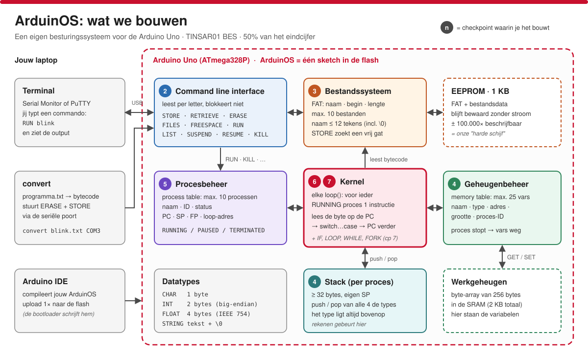
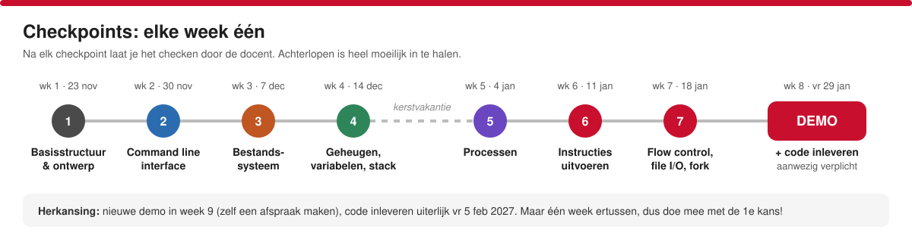

# ArduinOS: wat moeten we maken?

Samenvatting van de BES-eindopdracht (50% van je eindcijfer). Alles komt uit de [practicumhandleiding ArduinOS](../../../Handleidingen/handleiding_ArduinOS.pdf) en de [cursushandleiding](../../../Handleidingen/cursushandleiding_TINSAR01.pdf). Twijfel je? Dan geldt de handleiding.



## In het kort

Een Arduino Uno heeft **geen besturingssysteem**. Er staat alleen een kleine *bootloader* op, die een nieuw programma in de flash zet en daarna niks meer doet. Je code draait dus direct op de chip (*bare metal*): één programma tegelijk, geen bestanden, en voor een ander programma moet je opnieuw uploaden.

Wij bouwen een OS dat dat oplost:

- **Multitasking:** meerdere programma's tegelijk.
- **Bestandssysteem:** bestanden in het EEPROM, die blijven bewaard zonder stroom.
- **Geheugenbeheer:** variabelen per proces.
- **Command line interface:** commando's typen via de seriële monitor.

ArduinOS zelf is **één sketch** in C++ die je 1× uploadt. De programma's die ArduinOS draait zijn geen C++, maar **bytecode**: een rij bytes die als bestand in het EEPROM staat. Jouw OS leest die byte voor byte en voert ze uit. Het is dus eigenlijk een *interpreter*, een soort mini Java/Python-VM.

> Samenwerken mag, maar je levert **individueel** in en moet je eigen code bij de demo kunnen uitleggen.

## Requirements

| Onderdeel   | Eis                                                                                         |
| ----------- | ------------------------------------------------------------------------------------------- |
| Taal        | C++, voldoet aan de code-standaarden (TI 3×3)                                               |
| Invoer      | commando's via de seriële terminal                                                          |
| Geheugen    | minimaal **256 bytes** werkgeheugen                                                         |
| Variabelen  | minimaal **25**, van type CHAR, INT, FLOAT of STRING: zetten, lezen en aanpassen            |
| Bestanden   | bestandssysteem zo groot als het EEPROM, minimaal **10 bestanden**, naam max. **12 tekens** incl. `\0` |
| Vrije ruimte | kan de nog beschikbare opslag tonen                                                        |
| Processen   | tot **10** tegelijk: starten, pauzeren, hervatten, stoppen                                  |
| Opruimen    | weet van iedere variabele bij welk proces hij hoort en geeft die vrij als het proces stopt  |
| File I/O    | per proces **1 bestand** tegelijk lezen of schrijven                                        |
| Stack       | per proces een stack van minimaal **32 bytes**                                              |

## De onderdelen

| Onderdeel                  | Wat doet het?                                                                                                                               | Checkpoint |
| -------------------------- | ------------------------------------------------------------------------------------------------------------------------------------------- | :--------: |
| **Command line interface** | Leest wat je typt, letter voor letter. Herkent het commando en voert de bijbehorende functie uit.                                            | 2          |
| **Bestandssysteem**        | Een **FAT** (file allocation table) in het EEPROM houdt per bestand de naam, de beginpositie en de lengte bij. Toevoegen, opvragen, wissen, vrije ruimte. | 3          |
| **Geheugenbeheer**         | Een **memory table** houdt per variabele de naam, het type, het adres, de grootte en het proces bij. Variabelen gaan van de stack naar het geheugen en terug. | 4          |
| **Stack**                  | Tijdelijke opslag per proces: hier komen argumenten en resultaten van berekeningen. Push en pop voor alle 4 de types.                       | 4          |
| **Procesbeheer**           | Een **process table** houdt per proces de naam, het ID, de status en de registers bij: **PC** (program counter), **SP** (stack pointer), **FP** (file pointer) en het loop-adres. | 5          |
| **Kernel (uitvoeren)**     | Elke `loop()`: voor ieder RUNNING proces 1 instructie. Leest de byte op de PC, `switch…case`, voert uit, schuift de PC op.                  | 6 en 7     |

### Commando's

| Commando                 | Wat het doet                              |
| ------------------------ | ----------------------------------------- |
| `STORE bestand grootte`  | bestand opslaan (data komt daarna via serieel) |
| `RETRIEVE bestand`       | bestand tonen                             |
| `ERASE bestand`          | bestand wissen                            |
| `FILES`                  | lijst van bestanden met grootte           |
| `FREESPACE`              | grootste vrije ruimte in het EEPROM       |
| `RUN bestand`            | programma starten als nieuw proces        |
| `LIST`                   | lijst van processen (ID, status, naam)    |
| `SUSPEND id`             | proces pauzeren                           |
| `RESUME id`              | proces hervatten                          |
| `KILL id`                | proces stoppen (en z'n variabelen wissen) |

Tip uit de handleiding: maak een abstracte base class `Command` (met `name`, `requiredArgs` en `virtual void execute(...) = 0`), een afgeleide class per commando, en loop met een `for` door een array van pointers. Dat is netter dan een lange rij `if...else if`.

## Hoe draait een programma?

1. Je schrijft een programma als tekst, bijv. `blink.txt`.
2. `convert blink.txt COM3` op je laptop maakt er bytecode van en stuurt het met `STORE` naar het bestandssysteem.
3. Jij typt `RUN blink`, en ArduinOS maakt een nieuw proces aan met de **PC** op het begin van het bestand.
4. Elke `loop()` voert de kernel van ieder lopend proces **één** instructie uit. Zo lijken alle programma's tegelijk te draaien.

### Voorbeeld: `int a = 300;` in bytecode

```text
INT 1 44     zet 1 × 256 + 44 = 300 als INT op de stack
SET 'a'      haal het van de stack en sla het op als variabele a
```

Na `INT 1 44` ziet de stack er zo uit (bovenaan = top):

```text
INT    <- type bovenop, zodat je weet hoeveel bytes je moet poppen
44     <- lage byte
1      <- hoge byte
```

Rekenen gaat ook via de stack: `GET 'a'  INT 0 3  PLUS  SET 'b'` betekent `b = a + 3`. `PLUS` popt 2 waarden en pusht de som.

Een STRING staat er **achterstevoren** op, met de lengte en het type erboven: `'H' 'e' 'l' 'l' 'o' 0 6 STRING`.

## Planning



| Checkpoint | Week          | Wat moet de docent zien?                                                                                       |
| :--------: | ------------- | -------------------------------------------------------------------------------------------------------------- |
| 1          | wk 1 · 23 nov | Ontwerp + lijst van classes en functies (naam, argumenten, return value, wat het doet) + **stubs** met commentaar |
| 2          | wk 2 · 30 nov | Command line interface: alle commando's als classes, juiste aantal argumenten, stubs printen naam + argumenten |
| 3          | wk 3 · 7 dec  | Bestandssysteem: STORE, RETRIEVE, ERASE, FILES, FREESPACE werken                                               |
| 4          | wk 4 · 14 dec | Testcode: alle 4 de types pushen, als variabele opslaan, teruglezen, poppen en een variabele aanpassen          |
| 5          | wk 5 · 4 jan  | Processen starten, pauzeren en stoppen, met steeds `LIST` ertussen                                             |
| 6          | wk 6 · 11 jan | Instructies uitvoeren, minimaal: CHAR, INT, FLOAT, STRING, SET, GET, PRINTLN, PLUS, MINUS, INCREMENT, DECREMENT |
| 7          | wk 7 · 18 jan | Flow control, minimaal: STOP, IF, ELSE, ENDIF, LOOP, ENDLOOP, WHILE, ENDWHILE, MILLIS, DELAYUNTIL + meerdere programma's tegelijk |

**Demo:** vrijdag 29 januari (week 8). Aanwezigheid verplicht. Je laat je OS zien, krijgt vragen over je code, en levert de broncode in op Brightspace. Na de kerst kun je op vrijdag al delen laten nakijken (op aanvraag).

## Beoordeling

Per punt krijg je 0, ½ of 1 punt (niet, half of helemaal). Je cijfer is de som, max. 10.

| #   | Criterium                                                                      | Hoe laat je het zien?                          |
| --- | ------------------------------------------------------------------------------ | ---------------------------------------------- |
| 1   | OS leest commando's van de command line                                        | een willekeurig commando uitvoeren             |
| 2   | Bestanden opslaan, lijst tonen, inhoud tonen, wissen, vrije ruimte tonen       | bestand maken, uitlezen, wissen + `FREESPACE`  |
| 3   | Variabelen CHAR, INT, FLOAT, STRING opslaan, teruglezen en aanpassen           | programma `test_vars`                          |
| 4   | Bestand als proces starten, pauzeren en stoppen                                | programma met een loop starten, pauzeren, hervatten, stoppen |
| 5   | Per proces de status, PC en variabelen bijhouden                               | lijst van processen tonen (+ in de code)       |
| 6   | Bytecode-instructies uitvoeren                                                 | een bytecode-programma draaien                 |
| 7   | Meerdere processen tegelijk (om en om 1 instructie)                            | 2 programma's met een loop tegelijk            |
| 8   | Vanuit bytecode CHAR, INT, FLOAT, STRING naar bestanden schrijven en lezen     | `write_file` en `read_file`                    |
| 9   | Vanuit bytecode andere processen starten (fork) en wachten tot ze klaar zijn  | `test_fork`                                    |

**Bonus** (telt alleen mee als je bij 1–9 minimaal 6 punten hebt): prioriteiten voor processen, shared memory, semaforen, of een compiler van (een soort) C/Python naar bytecode.

## Handige tips uit de handleiding

- **Input mag niet blokkeren.** Lees met `Serial.available()` letter voor letter in een buffer, anders staan alle processen stil terwijl je typt.
- **Gebruik `MILLIS` + `DELAYUNTIL`, niet `DELAY`.** `DELAY` legt het hele OS en alle processen stil.
- **EEPROM gaat niet oneindig mee:** na ± 100.000 schrijfacties kan het kapot gaan. Schrijf dus niet in een loop naar het EEPROM.
- **Vrije ruimte zoeken** (voor bestanden én variabelen): sorteer de tabel op beginadres en kijk naar de gaten tussen het eind van het ene item en het begin van het volgende.
- **`popVal()`:** maak een functie die zelf kijkt welk getaltype er bovenop de stack ligt en het als `float` teruggeeft. Veel instructies maakt het type niet uit.
- **Blijf bij met de checkpoints.** Elk checkpoint bouwt voort op het vorige.

## Changelog

| Versie | Datum    | Change                                         |
| ------ | -------- | ---------------------------------------------- |
| 1.0    | 25/11/26 | + ArduinOS overzicht, infographics en planning |
