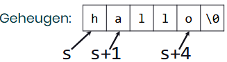

# System Architecture

## Eindopdracht:

Bouw je eigen besturingssysteem.

Wat houd dit in?

- Ontwerp en bout een operating system voor de Arduino UNO: ArduinOS.

  - Multitasking: meerdere processen tegelijk.
  - Bestandssysteem (non-volatile).
  - Geheugenbeheer.
  - Commad line interface (input/ output).
- Waarom Arduino?

  - Nog geen OS.
  - Uitdagin m.b.t. geheugen.
- Programmeertaal: C++
- Samenwerken toegestaan, maar individueel inleveren en toelichten.

## **Besturingssystemen les 1: Booting up**

### Planning?

- Wat is een OS?
- Wat is een kernel?
- Herhaling C++
- Blokdiagram OS

### Wat is een besturingssysteem?

Een operating system (OS) is de centrale software op een apparaat dat alles bestuurt.

De laag die tussen de fysieke wereld en digitale wereld zit.

Bekendste OS:

- Windows
- MacOS
- Android
- iOS
- Linux

### Wat is Linux?

Linux is een ***Open Source*** versie van ***UNIX***.

UNIX is een multi-processing OS uit de 70's.

Stabiel platform wat veilig is.

Bediening is vooral via de Command Line Interface (CLI).

	- Typ commando's om programma's te starten

	- Nu ook met Graphical User Interface (GUI)

Linux is/kan multi user zijn. iedereen heeft dan zijn eigen home directory /dir.

Je hebt niet net als windows toegang tot andere hun bestanden behalve als deze vrijgegeven zijn.

Alleen de super-gebruiker (***root***) heeft toegang tot alles ==> net als jezelf admin en full premissions geven in windows alleen standaard

Het concept is simpel, kleine programma's zijn goed in een specifieke taak en worden gecombineerd tot complexe acties.


**In vergelijking met andere OS'en:**

- Minder gebruikvriendelijk voor beginners en niet IT'ers
- Meer geschikt voor heavy-duty toepassingen zoals servers en procesbesturing in de industrie

Linux is alleen de kernel, GNU alle hulpprogramma's.

### Wat is een kernel?

"De *kernel* is de kern van een OS waarmee alle hardware op basisniveau aangestuurd wordt."

Linux kernel: geschreven door Linus Torvalds in 1991 in C

Most recente versie: **7.2**

Dit is ook de basis van Android (andere soort OS).

#### Wat doet de kernel?

| col1                                      | col2                                                                                                           |
| ----------------------------------------- | -------------------------------------------------------------------------------------------------------------- |
| **Bestuurt de processor(en)**       | Houdt bij welke processen draaien en hoeveel processortijd de krijgen (prioriteit)                             |
| **Geheugenbeheer**                  | Bepaalt welke delen dan het geheugen worden gebruikt voor het opslaan van programma's en data                  |
| **Beheer van I/O-apparaten**        | (toetsenbord, muis, USB-apparaten, netwerkkaart enz.): Bepaalt welk programma toegang kruigt tot welk apparaat |
| **Bestandssysteem**                 | Beheert de toegang tot opslagmedia en harde schijven                                                           |
| **Inter-Proces-Communicatie (IPC)** | Zorgt ervoor dat data en resources (bij. geheugen) gedeeld kunnen worden tussen processen                      |

#### Distributies

Distro: "Linux kernel samen met hulpprogramma's, applicaties, package manager, installatieprogramma."

Een distro is geoptimaliseerd voor andere functionaliteiten. Het heeft ook verschillende desktop enviroment (grafische verschillen en andere keuzes).

Vaak verspreid als .iso bestand of on-line.

In praktijk gaan we uit van ***Debian*.**

### Virtual machines

Wat is een virtual machine? "Een programma dat een complete computer simuleert". Je kunt hier net als een computer een OS op installeren, bijv. windows, linux.

Veel servers zijn virtual machines, denk aan de servers die wij vorig jaar hebben gebruikt voor de medicijn kluizen.

**Voordelen:**

- Veilig: een indringer komt niet bij de echt hardware.
- Makkelijk verschillende OS'en uitproberen.
- Makkelijk "bijschakelen" indien nodig.

 **Nadeel:**  iets minder performance

### Herhaling C++

**Klasse**

```C++
class MyClass {
	public:
		int field = 0;
		void method() {
		...
	}
	MyClass() { // constructor
		...
	}
	private:
		float privateField = 0.0;
};
```

**Objects instantieren**

```C++
MyClass object1; // statisch
MyClass *object2 = new MyClass; // dynamisch
...
delete object2;
```

**Afgeleide klasse**

```C++
class aClass {
...
};
class MyClass : public aClass {
...
};
```

**Abstracte klasse**

```C++
class aClass {
	virtual void myFunc() = 0;
};
class MyClass : public aClass {
	void MyFunc() {
		...
	}
};
```

- Zorgt ervoor dat je meerdere klasses kan hebben met dezelfde basis.

**Pointers**

```C++
int a = 3;			// Reserveer geheugen en sla getal 3 op
int *pa = &a;		// Pointer naar de geheugenplek
*pa = 5;			// Verander de waarde ==> a is nu 5
pa = &b;			/* Verander de pointers endpoint nu verwijst
					   nu naar b en niet a */
```

**Pointers en strings**



```C++
char *s = "hallo";		// pointer s verwijst naar de geheugenplek van de string

std::cout << s + 1;		// print allo
std::cout << s[2];		// print "l" dus maar 1 deel van de character array
std::cout << *(s + 4)	// print "o"
```

**Arrays en pointers**

```C++
int i[] = {2, 4, 6};		// Verwijs naar eerste geheugenplaats van array

std::cout << i[1];			// Print 4
std::cout *(i + 2);			// Print 6

const int LEN = 10;			// Reserveert 10 geheugenplaatsen
char s[LEN];				// Verwijst naar eerst geheugenplaats

strncpy(s, "hallo", LEN);	// Kopieert tekst naar de character array
```

**C-Style string**

```C++
char a[] = "c-style string";	// Null-terminated character array

String b("string object");		// Arduino String class
b.lenght();						// Handige method
if (b == "a string") {			// == operator overloaded
  ...
}
b += " concatenation";			// += operator overloaded
```

**References**

```C++
#include <iostream>

void func(int &x) {						// Stelt je instaat om variable in functie
  x += 2;								// aan te passen
}

int main() {							// Voorkomt kopieren van grote objecten
  int a = 3;							// bespaart geheugen
  std::cout << "a = " << a << std::endl;
  func(a);
  std::cout << "a = " << a << std::endl;
  return 0;
}
```

**Structs**

```C++
struct Naw {
	char naam[10];
	char straat[10];
	int huisNo;
};
Naw persoon;
strncpy(persoon.naam, "Jan", 10);
persoon.huisNo = 5;
```

Een struct is net als klasse gewoon te gebruiken als standaard variabelen. Je kan ze net als een klasse instantieren:

```C++
Naw persoon2 = persoon;
```

**Strucst en pointers**

- Gebruik pointers naar structs:

```C++
Naw *pPersoon = &persoon;
```

- persoon en *pPersoon verwijzen nu naar hetzelde stuk geheugen

```C++
pPersoon->huisNo = 10;
std::out << persoon.huisNo;
```

- Gebruik een pointer of reference om structs als argumenten of return values van functies te gebruiken
  - Minder kopieerwerk
  - mogelijkheid om inhoud van struct in de funtie te veranderen

### Blokdiagram

De blok diagram van de les is irrelevant voor de notes, kijk naar de opdracht [ArduinOS](https://github.com/ccylianoc/System-Architecture/tree/main/Opdrachten/Opdrachten/ArduinOS) in de readme is dit blokdiagram uitgewerkt.

## **Besturingssystemen les 2:**

## Changelog

| Versie | Datum    | Change                                      |
| ------ | -------- | ------------------------------------------- |
| 1.0    | 25/11/26 | + BES.md aangemaakt<br />+ Les 1 toegevoegd |
|        |          |                                             |
