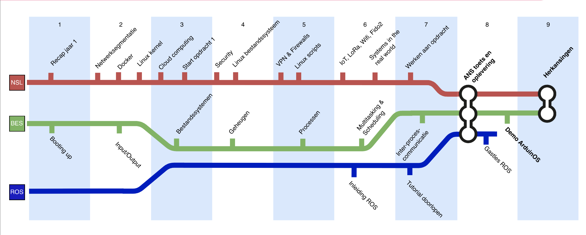

# System Architecture

**Les 1 maandag 23 nov**

Waar gaat dit vak over?

- Het ontwerpen van **grote complexe systemen**
- Subsytemen met netwerk verbindingen
- Eigen aansturing en centrale aansturing

Praktische zaken:

- Cursus handleiding op Brightspace
- Drie trajecten

  - **BES**turingssystemen
  - **N**etwerken, **S**ecurity, **L**inux
  - **R**obot **O**perating **S**ystem
- 3 x per week les:

  - ma + wo: theorie en oefenen
  - vr: onder begeleiding werken aan opdrachten
- Aanvullende informatie

  - Voorbeeldcode en opgave op git
  - Links staan op brightspace
  - Youtube
- Metrokaart:

Toetsing:

- **NSL**: 2 opdrachten, hier wordt een deel van de stof getoetst ==> NIET MISSEN!
- **BES**: doorlopen opdracht + demonstratie: ArduinOS
- **NSL** + **BES** + **ROS**: schriftelijke kennistoets over alle theorie (ANS, week 8)

| Onderdeel       | Beschrijving                                                       | Weging |
| --------------- | ------------------------------------------------------------------ | ------ |
| NSL opdracht 1  | kleine opdracht equivalent puntenaantal met de andere NSL opdracht | 0,125  |
| NSL opdracht 2  | kleine opdracht equivalent puntenaantal met de andere NSL opdracht | 0,125  |
| ArduinOS        | 1 grote opdracht                                                   | 0.5    |
| ANS kennistoets | stof van NSL, BES en ROS                                           | 0,25   |

## Changelog

| Versie | Datum    | Change        |
| ------ | -------- | ------------- |
| 1.0    | 23/11/26 | + algemeen.md |
| 1.1    | 25/11/26 | + changelog   |
